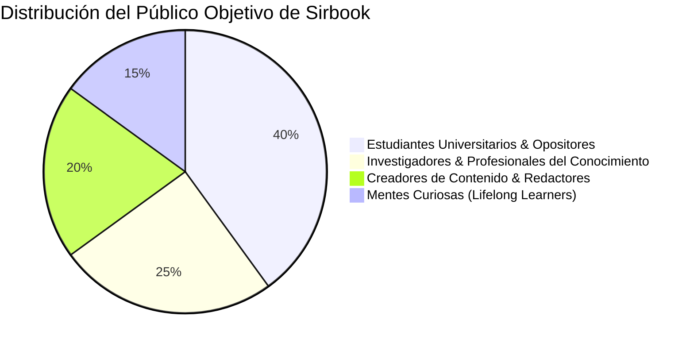
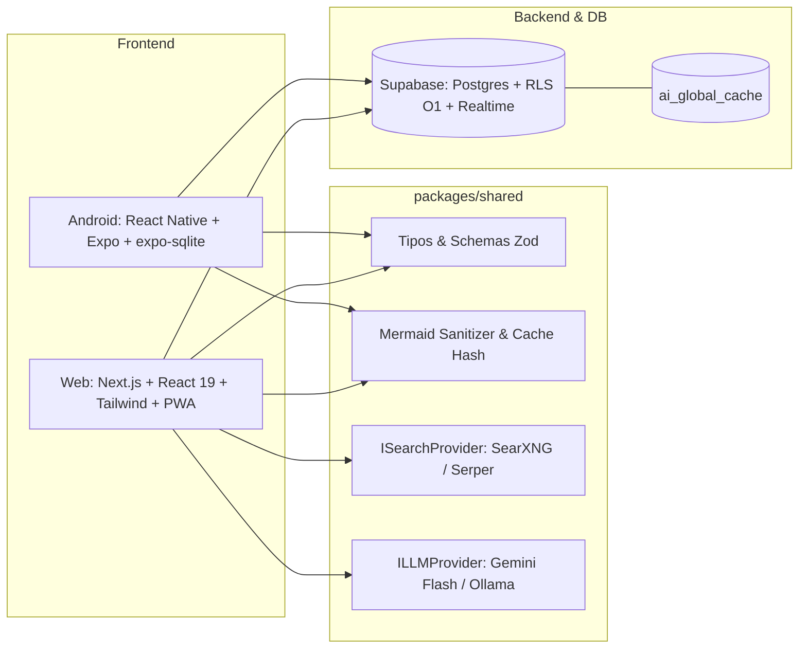
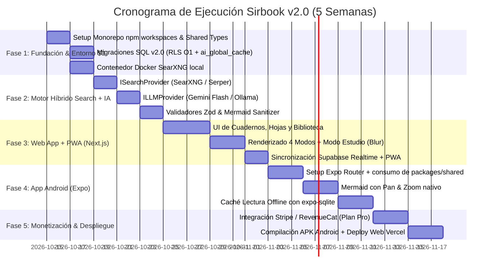

# Sirbook (v2.0) 📓⚡
*Plataforma de Cuadernos Inteligentes Multiplataforma (Android + Web) con Arquitectura Híbrida Search-First + Structured LLM*

---

## 📌 1. Contexto del Proyecto

El mercado del software de notas y gestión del conocimiento personal (**Personal Knowledge Management - PKM**) está polarizado en dos extremos:
1. **Herramientas pasivas y manuales (Google Keep, Apple Notes, OneNote):** Requieren que el usuario redacte todo a mano, estructurando la información línea por línea. Esto produce fricción, lentitud y desorganización.
2. **Plataformas complejas y abrumadoras (Notion, Obsidian, Roam Research):** Exigen una curva de aprendizaje alta para configurar bases de datos, plantillas y enlaces bidireccionales.
3. **Chatbots de IA genéricos (ChatGPT, Perplexity):** Aunque generan respuestas rápidas, las conversaciones son lineales y efímeras; no están organizadas como cuadernos de estudio o trabajo persistentes, y las respuestas suelen ser muros de texto homogéneos con riesgo de alucinaciones.

### La Tesis de Sirbook
> **De "tomar notas" a "sintetizar conocimiento estructurado en segundos":** El usuario no tiene que redactar párrafos enteros; simplemente ingresa las **palabras clave o temas** que necesita aprender o documentar dentro de un cuaderno, y **Sirbook genera el contenido estructurado, verificado en internet y adaptado al formato exacto requerido** (conceptos claros, diagramas visuales o curiosidades estadísticas).

---

## 🎯 2. ¿Qué Problemas Busca Resolver?

| Problema Actual | Solución de Sirbook (v2.0) |
| :--- | :--- |
| **Síndrome de la página en blanco y fatiga de escritura** | El usuario solo escribe una palabra clave. La IA investiga y estructura el contenido automáticamente en el cuaderno. |
| **Alucinaciones y costos excesivos de Grounding** | **Pipeline desacoplado Search-First + Structured LLM**. Se recupera información web real mediante SearXNG (local) o Serper ($1/1k) y se inyecta en el LLM (Gemini Flash) con Zod Structured Output determinista. |
| **Polisemia y desvío temático** | **Herencia de Contexto (`context_path`):** El prompt inyecta la jerarquía `Cuaderno > Sección > Palabra Clave` para que "Mercurio" en *Química* genere el elemento Hg y en *Astronomía* el planeta. |
| **Muros de texto y baja retención** | División en 4 modos intencionales (Concepto, Gráfico Mermaid, Dato curioso y Libre) + **Modo Estudio / Flashcards** con difuminado (*blur*) para repaso activo. |
| **Inconsistencias y cuellos de botella en DB** | Esquema Supabase desnormalizado con `user_id` directo y políticas **RLS $O(1)$ sin JOINs anidados**. |
| **Fragmentación entre móvil y escritorio** | Sincronización instantánea en la nube entre **Web** (Next.js) y **Android** (React Native / Expo) con soporte de **Lectura Offline Instantánea** vía `expo-sqlite`. |

---

## 👥 3. Público Objetivo (User Personas)



### 1. Estudiantes Universitarios y Opositores (40%)
* **Necesidad:** Preparar asignaturas extensas, memorizar definiciones precisas y visualizar relaciones conceptuales rápidamente.
* **Uso en Sirbook:** Crean un cuaderno por materia (ej. *"Derecho Constitucional"* o *"Bioquímica"*). Introducen conceptos clave y repasan con el **Modo Estudio (Flashcards con Blur)** desde su teléfono Android o laptop.

### 2. Investigadores, Consultores y Profesionales (25%)
* **Necesidad:** Recopilar datos cuantitativos, métricas de mercado y resúmenes ejecutivos con fuentes contrastadas para informes o presentaciones.
* **Uso en Sirbook:** Utilizan el **Modo Dato/Curiosidad** y **Modo Concepto** para alimentar cuadernos de proyectos con cifras verificadas en internet sin perder tiempo en decenas de pestañas.

### 3. Creadores de Contenido, Escritores y Podcasters (20%)
* **Necesidad:** Encontrar ganchos (*hooks*), datos curiosos insólitos y estructuras narrativas para guiones de YouTube, TikTok, newsletters o hilos de X.
* **Uso en Sirbook:** Utilizan el **Modo Dato o Curiosidad** como fábrica de ganchos basados en palabras clave de tendencia.

### 4. Mentes Curiosas / Lifelong Learners (15%)
* **Necesidad:** Personas autodidactas que desean aprender sobre historia, tecnología, filosofía o finanzas personales de manera estructurada y visual.

---

## ⚡ 4. Nivel de Utilidad y Ventajas Competitivas (USP)

### Factores Clave de Utilidad:
1. **Ahorro de Tiempo 10x:** Investigar un tema en Google, sintetizarlo y armar un esquema toma entre 30 y 45 minutos. En Sirbook toma **10 segundos**.
2. **Comprensión Multimodal Instantánea:** Elección entre un mapa mental en Mermaid (`Gráfico`), una tabla estadística (`Gráfico`), una cápsula de impacto (`Dato`) o un desglose analítico (`Concepto`).
3. **Caché Semántico Global a Costo $0:** Consultas sobre temas recurrentes se sirven desde la tabla `ai_global_cache` en `< 100ms` sin llamadas redundantes a APIs externas.
4. **Active Recall Integrado:** Modo Estudio con difuminado para transformar notas generadas en tarjetas de repaso activo tipo Anki.

### Tabla Comparativa Frente a la Competencia

| Característica | Sirbook v2.0 | Notion AI | ChatGPT / Perplexity | Google Keep |
| :--- | :---: | :---: | :---: | :---: |
| **Generación por palabras clave contextualizadas** | ✅ **Nativo** | ❌ (Requiere prompts) | ❌ (Requiere prompts) | ❌ |
| **Búsqueda Web desacoplada y determinista** | ✅ **Nativo ($1/1k)** | ❌ (Búsqueda limitada) | ⚠️ (Plan de pago) | ❌ |
| **Caché Semántico Global (< 100ms)** | ✅ **Nativo** | ❌ | ❌ | ❌ |
| **Modos dedicados (Concepto / Gráfico / Dato / Libre)**| ✅ **Especializados** | ❌ | ❌ | ❌ |
| **Mermaid Sanitizer & Pan-Zoom interactivo** | ✅ **Nativo** | ❌ (Manual) | ⚠️ (Solo código) | ❌ |
| **Modo Estudio (Flashcards Blur)** | ✅ **Nativo** | ❌ | ❌ | ❌ |
| **Organización en Cuadernos estructurados** | ✅ **Nativo** | ✅ | ❌ (Hilos sueltos) | ⚠️ (Solo etiquetas) |
| **Sincronización Web + Android con Lectura Offline** | ✅ **Nativo** | ✅ | ✅ | ✅ |

---

## 💰 5. Modelo de Negocio y Unit Economics Sostenibles

```mermaid
graph TD
    A[Estrategia de Monetización Sirbook v2.0] --> B[1. Modelo Freemium Sostenible]
    A --> C[2. Enrutamiento Inteligente / Smart Routing]
    A --> D[3. Marketplace de Cuadernos]
    A --> E[4. Planes Educativos y Equipos B2B]

    B --> B1[Plan Free: 3 cuadernos, 30 bloques IA/mes, Caché ilimitado]
    B --> B2[Plan Pro $6.99/mes: Bloques ilimitados + 300 Deep Web Searches]
    
    C --> C1[Temas consolidados van a LLM sin búsqueda web para margen >80%]
    D --> D1[Creadores venden cuadernos curados (Comisión 70/30)]
    E --> E1[Licencias institucionales para academias y universidades]
```

### 1. Modelo Freemium
* **Nivel Gratuito (Starter):**
  * Hasta 3 Cuadernos activos.
  * 30 bloques generados con IA al mes (consultas a caché no consumen cuota).
  * Sincronización en 2 dispositivos.
  * Modo Libre y Modo Estudio ilimitados.
* **Nivel Pro ($6.99 USD/mes o $59 USD/año):**
  * Cuadernos y secciones ilimitados.
  * Generaciones de IA estándar ilimitadas.
  * **300 Búsquedas Web en Vivo (Deep Web Search) al mes** incluidas (protegiendo el margen operativo > 80%).
  * Exportación profesional (PDF estructurado, Markdown y formato Anki).
  * Búsqueda semántica global en todos los cuadernos.

### 2. Gestión de Pagos Multiplataforma
* **Web:** Stripe / LemonSqueezy.
* **Móvil Android:** Sincronización de suscripción mediante **RevenueCat** o modelo *Reader App* para optimizar comisiones de tienda.

---

## 🛠️ 6. Stack Tecnológico & Arquitectura v2.0



* **Frontend Web (`apps/web`):**
  * **Next.js (App Router) + React 19 / TypeScript + Tailwind CSS.**
  * Renderizado interactivo de diagramas con **Mermaid.js**, gráficos con **Recharts** y editor enriquecido TipTap.
  * Soporte PWA para instalación web inmediata.
* **Frontend Android (`apps/mobile`):**
  * **React Native con Expo (Expo Router + TypeScript).**
  * Visor de Mermaid con **Pan & Zoom** y soporte de **Lectura Offline** con `expo-sqlite` / TanStack Query persistente.
* **Paquete Compartido (`packages/shared`):**
  * Tipos de TypeScript y esquemas Zod con herencia de contexto (`context_path`).
  * `mermaid-sanitizer.ts`: Saneamiento de sintaxis Mermaid antes de renderizar.
  * `cache-hash.ts`: Hashing SHA-256 para `ai_global_cache`.
  * Patrón Strategy para `ISearchProvider` (SearXNG / Serper) e `ILLMProvider` (Gemini Flash / Ollama).
* **Backend & Base de Datos:**
  * **Supabase PostgreSQL:** Tablas optimizadas con `user_id` desnormalizado para **RLS en $O(1)$ sin subconsultas pesadas**.
  * **Docker Local:** Contenedor de **SearXNG** para desarrollo y pruebas a costo $0.

---

## 🧠 7. Lógica y Especificación de los 4 Modos

Cada llamada a la API utiliza un JSON Schema riguroso con herencia de contexto (`notebookTitle > sectionTitle > keyword`):

### 1. 📚 Modo Conceptos
* **Estructura JSON generada:**
  ```json
  {
    "modo": "concepto",
    "titulo": "Mitosis",
    "contexto": "Biología Celular > Ciclo Celular",
    "definicion_corta": "Proceso de división celular en el que una célula madre produce dos células hijas idénticas...",
    "puntos_clave": [
      "Fases: Profase, Metafase, Anafase y Telofase.",
      "Mantiene el número diploide de cromosomas constante."
    ],
    "aplicaciones": ["Crecimiento de tejidos", "Regeneración celular"],
    "fuentes": [{ "titulo": "Khan Academy Biología", "url": "https://..." }]
  }
  ```

### 2. 📊 Modo Gráficos (con Mermaid Sanitizer)
* **Estructura JSON generada:**
  ```json
  {
    "modo": "grafico",
    "tipo_grafico": "mermaid_flowchart",
    "titulo": "Ciclo de Krebs",
    "contexto": "Bioquímica > Metabolismo Energético",
    "codigo_render": "graph TD;\n  A[\"Citrato\"] --> B[\"Isocitrato\"];\n  B --> C[\"Alfa-cetoglutarato\"];\n  C --> D[\"Succinil-CoA\"];",
    "descripcion_corta": "Ruta metabólica central de la respiración celular aeróbica.",
    "fuentes": [{ "titulo": "Nature Education", "url": "https://..." }]
  }
  ```

### 3. 💡 Modo Dato o Curiosidad
* **Estructura JSON generada:**
  ```json
  {
    "modo": "dato",
    "titular": "ADN Humano y el Genoma del Plátano",
    "contexto": "Genética > Evolución y Homología",
    "cifra_destacada": "60% de similitud",
    "explicacion": "Los seres humanos comparten cerca del 60% de sus genes con los plátanos para funciones metabólicas celulares básicas.",
    "fuente_verificada": { "titulo": "NHGRI Genome", "url": "https://..." }
  }
  ```

### 4. ✏️ Modo Libre
* **Estructura:** Editor Markdown / TipTap con soporte para títulos, listas, fórmulas matemáticas (KaTeX), citas y fragmentos de código, sin intervención de IA.

---

## 🗄️ 8. Esquema de Base de Datos Optimizado (Supabase PostgreSQL v2.0)

```sql
-- 1. Cuadernos principales
CREATE TABLE notebooks (
    id UUID PRIMARY KEY DEFAULT gen_random_uuid(),
    user_id UUID NOT NULL REFERENCES auth.users(id) ON DELETE CASCADE,
    title TEXT NOT NULL,
    description TEXT,
    cover_color TEXT DEFAULT '#4F46E5',
    icon TEXT DEFAULT 'book',
    created_at TIMESTAMPTZ DEFAULT NOW(),
    updated_at TIMESTAMPTZ DEFAULT NOW()
);

-- 2. Secciones (Desnormalizado con user_id para RLS instantáneo O(1))
CREATE TABLE sections (
    id UUID PRIMARY KEY DEFAULT gen_random_uuid(),
    notebook_id UUID NOT NULL REFERENCES notebooks(id) ON DELETE CASCADE,
    user_id UUID NOT NULL REFERENCES auth.users(id) ON DELETE CASCADE,
    title TEXT NOT NULL,
    position INT DEFAULT 0,
    created_at TIMESTAMPTZ DEFAULT NOW()
);

-- 3. Bloques inteligentes (Desnormalizado con user_id)
CREATE TABLE blocks (
    id UUID PRIMARY KEY DEFAULT gen_random_uuid(),
    section_id UUID NOT NULL REFERENCES sections(id) ON DELETE CASCADE,
    user_id UUID NOT NULL REFERENCES auth.users(id) ON DELETE CASCADE,
    mode TEXT NOT NULL CHECK (mode IN ('concept', 'graphic', 'curiosity', 'free')),
    keyword TEXT,
    context_path TEXT, -- Ej: "Bioquímica > Enzimas" para resolver polisemia
    content JSONB NOT NULL,
    position INT DEFAULT 0,
    created_at TIMESTAMPTZ DEFAULT NOW(),
    updated_at TIMESTAMPTZ DEFAULT NOW()
);

-- 4. Caché Semántico Global para reducir costos de IA y Búsqueda a $0
CREATE TABLE ai_global_cache (
    cache_key TEXT PRIMARY KEY, -- Hash SHA-256 de (normalized_keyword + mode + normalized_context)
    mode TEXT NOT NULL,
    keyword TEXT NOT NULL,
    context_path TEXT,
    response_json JSONB NOT NULL,
    created_at TIMESTAMPTZ DEFAULT NOW(),
    expires_at TIMESTAMPTZ DEFAULT (NOW() + INTERVAL '30 days')
);

-- Índices de Rendimiento
CREATE INDEX idx_notebooks_user ON notebooks(user_id);
CREATE INDEX idx_sections_notebook ON sections(notebook_id);
CREATE INDEX idx_sections_user ON sections(user_id);
CREATE INDEX idx_blocks_section ON blocks(section_id);
CREATE INDEX idx_blocks_user ON blocks(user_id);
CREATE INDEX idx_cache_expires ON ai_global_cache(expires_at);

-- Habilitar RLS (Row Level Security)
ALTER TABLE notebooks ENABLE ROW LEVEL SECURITY;
ALTER TABLE sections ENABLE ROW LEVEL SECURITY;
ALTER TABLE blocks ENABLE ROW LEVEL SECURITY;

-- Políticas RLS Optimizadas O(1) directas sin JOINs costosos
CREATE POLICY "Manage own notebooks" ON notebooks FOR ALL USING (auth.uid() = user_id);
CREATE POLICY "Manage own sections" ON sections FOR ALL USING (auth.uid() = user_id);
CREATE POLICY "Manage own blocks" ON blocks FOR ALL USING (auth.uid() = user_id);
```

---

## 📅 9. Cronograma Maestro Ajustado (MVP Realista sin Deuda Técnica)



---

## 📂 10. Estructura del Repositorio (Monorepo)

```
sirbook/
├── apps/
│   ├── web/                         # Aplicación Next.js (Web + PWA)
│   │   ├── app/                     # App Router (Páginas, Cuadernos, API /api/generate)
│   │   ├── components/              # Componentes de UI (Modo Estudio, Visores, Editor)
│   │   └── lib/                     # Clientes Supabase y utilidades web
│   └── mobile/                      # Aplicación Android (Expo / React Native)
│       ├── app/                     # Rutas de Expo Router
│       ├── components/              # Visores nativos y WebView Mermaid con Pan & Zoom
│       └── services/                # Base de datos local expo-sqlite para lectura offline
├── packages/
│   └── shared/                      # Paquete compartido de TypeScript
│       ├── src/
│       │   ├── types/               # Interfaces de Notebook, Section, Block, Cache
│       │   ├── schemas/             # Validadores Zod de los 4 modos y request
│       │   ├── prompts/             # Templates contextualizados (Notebook > Section > Keyword)
│       │   ├── utils/               # mermaid-sanitizer.ts y cache-hash.ts
│       │   └── services/
│       │       ├── search/          # ISearchProvider (SearXNG y Serper)
│       │       └── llm/             # ILLMProvider (Gemini Flash y Ollama)
│       └── package.json
├── supabase/
│   └── migrations/                  # Migraciones SQL v2.0 (tablas, índices, RLS O(1))
├── docker-compose.yml               # Contenedor SearXNG para desarrollo local a costo $0
├── package.json                     # Configuración de workspaces raíz
├── README.md                        # Documento maestro consolidado (v2.0)
└── correcciones.md                  # Informe de auditoría técnica original
```
